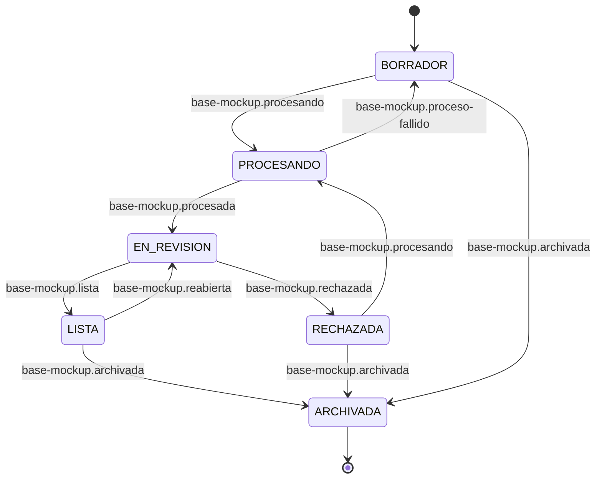

# Módulo: Bases de mockup

Fotos de prendas en blanco preparadas para mockup: recorte, mapas, zonas detectadas y escenas.

## Entidades

### BaseMockup (`bases_mockup`)
_alcance: global · borrado lógico · auditada_
Foto de una prenda en una vista lista para recibir diseños.

| Campo | Tipo | Reglas | Por defecto |
| --- | --- | --- | --- |
| modeloPrendaId | `uuid` |  |  |
| nombre | `string(120)` | requerido |  |
| categoria | `enum {PLAYERA, PLAYERA_VINTAGE, RAGLAN, HOODIE, SUDADERA, SHORT, PANTS, GORRA, TOTE, OTRA}` | requerido |  |
| vista | `enum {FRENTE, ESPALDA, IZQUIERDA, DERECHA, TRES_CUARTOS}` | requerido |  |
| origen | `enum {FOTO_PROPIA, PROVEEDOR, GENERADA_IA}` | requerido |  |
| estado | `enum {BORRADOR, PROCESANDO, EN_REVISION, LISTA, RECHAZADA, ARCHIVADA}` |  | BORRADOR |
| colorBase | `enum {BLANCO, CLARO, OSCURO}` |  | BLANCO |
| colorPrendaId | `uuid` |  |  |
| imagenOriginal | `image` | requerido |  |
| imagenPreparada | `image` |  |  |
| imagenRecorte | `image` |  |  |
| mascara | `image` |  |  |
| mapaDesplazamiento | `image` |  |  |
| mapaSombras | `image` |  |  |
| miniatura | `image` |  |  |
| anchoPx | `int` |  |  |
| altoPx | `int` |  |  |
| pxPorCm | `decimal(8,3)` |  |  |
| intensidadDesplazamiento | `decimal(4,2)` |  | 0.6 |
| usoIaGenerativa | `boolean` |  | false |
| analisisIa | `json` |  |  |
| notas | `text` |  |  |
| ultimaActividadId | `uuid` |  |  |

Índices compuestos: `(modeloPrendaId, vista)` · `(estado)`

#### Estados de BaseMockup (campo `estado`)
Estado inicial: `BORRADOR`. Solo se permiten estas transiciones.

| Desde | Hacia | Evento | Roles | Condición |
| --- | --- | --- | --- | --- |
| BORRADOR, RECHAZADA | PROCESANDO | base-mockup.procesando | Propietario |  |
| PROCESANDO | EN_REVISION | base-mockup.procesada |  |  |
| PROCESANDO | BORRADOR | base-mockup.proceso-fallido |  |  |
| EN_REVISION | LISTA | base-mockup.lista | Propietario | imagenRecorte != null && mapaDesplazamiento != null && zonas.Count > 0 |
| EN_REVISION | RECHAZADA | base-mockup.rechazada | Propietario |  |
| LISTA | EN_REVISION | base-mockup.reabierta | Propietario |  |
| LISTA, RECHAZADA, BORRADOR | ARCHIVADA | base-mockup.archivada | Propietario |  |

### ZonaBase (`zonas_base`)
_alcance: global_
Ubicación de una zona de impresión dentro de la foto (malla de puntos).

| Campo | Tipo | Reglas | Por defecto |
| --- | --- | --- | --- |
| baseMockupId | `uuid` | requerido |  |
| zonaImpresionId | `uuid` |  |  |
| nombre | `string(80)` | requerido |  |
| puntos | `json` | requerido |  |
| rotacionGrados | `decimal(6,2)` |  | 0 |
| curvatura | `decimal(4,2)` |  | 0 |
| origen | `enum {MANUAL, IA}` |  | MANUAL |
| confianzaIa | `percentage` |  |  |
| ultimaActividadId | `uuid` |  |  |

### Escena (`escenas`)
_alcance: global · borrado lógico_
Fondo y ambiente del mockup.

| Campo | Tipo | Reglas | Por defecto |
| --- | --- | --- | --- |
| nombre | `string(100)` | requerido |  |
| tipo | `enum {TRANSPARENTE, COLOR_SOLIDO, DEGRADADO, IMAGEN, GENERADA_IA}` |  | COLOR_SOLIDO |
| colorFondo | `color` |  |  |
| colorFondo2 | `color` |  |  |
| imagenFondo | `image` |  |  |
| sombraSuelo | `boolean` |  | true |
| configuracion | `json` |  |  |
| activa | `boolean` |  | true |
| ultimaActividadId | `uuid` |  |  |

## Relaciones

- BaseMockup.ultimaActividadId → `ManyToOne` → Actividad. (ultimaActividad)
- BaseMockup.modeloPrendaId → `ManyToOne` → ModeloPrenda. (modelo)
- BaseMockup.colorPrendaId → `ManyToOne` → ColorPrenda. (colorFijo)
- ZonaBase.ultimaActividadId → `ManyToOne` → Actividad. (ultimaActividad)
- ZonaBase.baseMockupId → `ManyToOne` → BaseMockup. (base)
- ZonaBase.zonaImpresionId → `ManyToOne` → ZonaImpresion. (zona)
- Escena.ultimaActividadId → `ManyToOne` → Actividad. (ultimaActividad)
- PerfilExportacion.escenaId → `ManyToOne` → Escena. (escena)
- LoteItem.baseMockupId → `ManyToOne` → BaseMockup. (base)
- LoteItem.escenaId → `ManyToOne` → Escena. (escena)

## API

| Método | Ruta | Auth | Roles | Descripción |
| --- | --- | --- | --- | --- |
| `GET` | `/api/bases` | sí |  |  |
| `POST` | `/api/bases` | sí |  | Multipart; también acepta imagen de color del proveedor |
| `GET` | `/api/bases/{id}` | sí |  |  |
| `PUT` | `/api/bases/{id}` | sí |  |  |
| `POST` | `/api/bases/{id}/procesar` | sí |  | Recorte local, máscara y mapas |
| `POST` | `/api/bases/{id}/ia/limpiar` | sí |  | Gemini: limpiar, enderezar o quitar arrugas |
| `POST` | `/api/bases/ia/generar` | sí |  | Gemini crea base blanca de una prenda nueva |
| `POST` | `/api/bases/{id}/ia/analizar` | sí |  | Claude: tipo, vista, zonas y calidad |
| `PUT` | `/api/bases/{id}/zonas` | sí |  |  |
| `POST` | `/api/bases/{id}/aprobar` | sí |  |  |
| `POST` | `/api/bases/{id}/rechazar` | sí |  |  |
| `POST` | `/api/bases/{id}/archivar` | sí |  |  |
| `GET` | `/api/escenas` | sí |  |  |
| `PUT` | `/api/escenas/{id}` | sí |  |  |
| `POST` | `/api/escenas/ia/generar` | sí |  |  |

## Pantallas

| Pantalla | Tipo | Ruta | Entidad | Roles |
| --- | --- | --- | --- | --- |
| Bases | List | `/bases` | BaseMockup |  |
| Nueva base | Wizard | `/bases/nueva` | BaseMockup |  |
| Editor de base | Detail | `/bases/:id` | BaseMockup |  |
| Escenas | List | `/bases/escenas` | Escena |  |
| Escena | Form | `/bases/escenas/:id` | Escena |  |

## Workflows

### Preparar base de mockup
De la foto subida a una base lista para recibir diseños.
Se dispara con: `base-mockup.procesando`

1. [trigger] Base enviada a procesar
2. [condition] ¿Limpiar con Gemini?
3. [ai] Limpiar y enderezar con Gemini
4. [approval] Aprobar imagen editada
5. [action] Recortar con BiRefNet
6. [action] Generar máscara y mapas
7. [ai] Detectar zonas con Claude
8. [action] Pasar a revisión
9. [notification] Avisar base lista para revisar
10. [end] Fin

## Eventos

| Evento | Se emite cuando | Payload |
| --- | --- | --- |
| `base-mockup.procesando` | on_state_change |  |
| `base-mockup.procesada` | on_state_change |  |
| `base-mockup.proceso-fallido` | on_state_change |  |
| `base-mockup.lista` | on_state_change |  |

## Reportes

| Reporte | Entidad | Columnas | Filtros |
| --- | --- | --- | --- |
| Bases por estado | BaseMockup | nombre, categoria, vista, origen, colorBase, estado | estado, categoria, vista, modeloPrendaId |

## Criterios de aceptación

- [ ] CRUD de BaseMockup con validación de campos requeridos y únicos.
- [ ] BaseMockup: el borrado es lógico (`deleted_at`) y las consultas excluyen lo borrado.
- [ ] BaseMockup: cada cambio registra quién, qué y cuándo.
- [ ] BaseMockup: solo las 7 transiciones del diagrama son válidas; las demás se rechazan con 409.
- [ ] BaseMockup: cada transición verifica el rol permitido y emite su evento.
- [ ] CRUD de ZonaBase con validación de campos requeridos y únicos.
- [ ] CRUD de Escena con validación de campos requeridos y únicos.
- [ ] Escena: el borrado es lógico (`deleted_at`) y las consultas excluyen lo borrado.
- [ ] Todas las rutas del apartado API existen con el método y la autenticación indicados.
- [ ] Cada pantalla respeta los roles requeridos y define estados de carga, vacío y error.
- [ ] Workflow "Preparar base de mockup": probar cada transición y los casos de rechazo.
- [ ] Los eventos se emiten con el payload indicado, de forma idempotente.
- [ ] Tests del módulo y type-check sin errores.

## Dónde trabajar
- Web: `apps/web/src/features/bases/`
