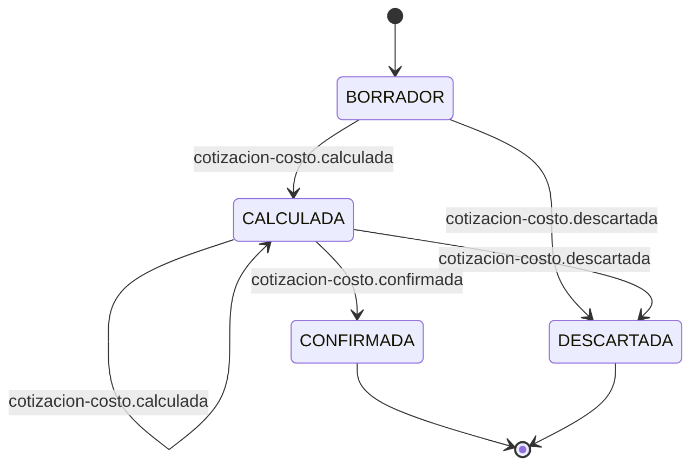

# Módulo: Costos de producción

Tarifas de maquila por reglas, costos adicionales y cotizaciones de costo por pieza.

## Entidades

### TarifaMaquila (`tarifas_maquila`)
_alcance: global · borrado lógico · auditada_
Precio total por pieza del maquilador (incluye prenda) según técnica, zonas, colores y cantidad.

| Campo | Tipo | Reglas | Por defecto |
| --- | --- | --- | --- |
| proveedorId | `uuid` | requerido |  |
| modeloPrendaId | `uuid` |  |  |
| nombre | `string(120)` | requerido |  |
| tecnica | `enum {SERIGRAFIA, DTF, BORDADO, VINIL, PUFF, DTG, SUBLIMACION}` | requerido |  |
| zonasMin | `smallint` |  | 1 |
| zonasMax | `smallint` |  |  |
| coloresMin | `smallint` |  | 1 |
| coloresMax | `smallint` |  |  |
| cantidadMin | `int` |  | 1 |
| cantidadMax | `int` |  |  |
| precioUnitario | `money` | requerido, mín 0 |  |
| incluyePrenda | `boolean` |  | true |
| incluyeEtiqueta | `boolean` |  | false |
| vigenteDesde | `date` |  |  |
| vigenteHasta | `date` |  |  |
| prioridad | `smallint` |  | 0 |
| activa | `boolean` |  | true |
| notas | `text` |  |  |
| ultimaActividadId | `uuid` |  |  |

Índices compuestos: `(proveedorId, tecnica, activa)`

### CostoAdicional (`costos_adicionales`)
_alcance: global · borrado lógico_
Etiqueta interna impresa, bolsa, envío por defecto y otros.

| Campo | Tipo | Reglas | Por defecto |
| --- | --- | --- | --- |
| proveedorId | `uuid` |  |  |
| nombre | `string(100)` | requerido |  |
| concepto | `enum {ETIQUETA_INTERNA, BOLSA, EMPAQUE, ENVIO, OTRO}` | requerido |  |
| aplicaPor | `enum {PIEZA, PEDIDO}` | requerido |  |
| monto | `money` | requerido, mín 0 |  |
| activo | `boolean` |  | true |
| ultimaActividadId | `uuid` |  |  |

### CotizacionCosto (`cotizaciones_costo`)
_alcance: global · auditada_
Cálculo del costo por pieza de una composición para una cantidad.

| Campo | Tipo | Reglas | Por defecto |
| --- | --- | --- | --- |
| folio | `string(20)` | requerido, único |  |
| marcaId | `uuid` | requerido |  |
| disenoId | `uuid` | requerido |  |
| composicionId | `uuid` | requerido |  |
| proveedorId | `uuid` | requerido |  |
| cantidad | `int` | requerido, mín 1 |  |
| tecnica | `enum {SERIGRAFIA, DTF, BORDADO, VINIL, PUFF, DTG, SUBLIMACION}` | requerido |  |
| numeroZonas | `smallint` | requerido |  |
| numeroColores | `smallint` | requerido |  |
| tarifaMaquilaId | `uuid` |  |  |
| precioMaquilaUnitario | `money` |  | 0 |
| adicionalesUnitario | `money` |  | 0 |
| envioPedido | `money` |  | 0 |
| envioUnitario | `money` |  | 0 |
| costoUnitario | `money` |  | 0 |
| costoTotal | `money` |  | 0 |
| desglose | `json` |  |  |
| estado | `enum {BORRADOR, CALCULADA, CONFIRMADA, DESCARTADA}` |  | BORRADOR |
| confirmadaEn | `datetime` |  |  |
| notas | `text` |  |  |
| ultimaActividadId | `uuid` |  |  |

#### Estados de CotizacionCosto (campo `estado`)
Estado inicial: `BORRADOR`. Solo se permiten estas transiciones.

| Desde | Hacia | Evento | Roles | Condición |
| --- | --- | --- | --- | --- |
| BORRADOR, CALCULADA | CALCULADA | cotizacion-costo.calculada | Propietario | existe tarifa aplicable |
| CALCULADA | CONFIRMADA | cotizacion-costo.confirmada | Propietario | suma de partidas == cantidad |
| BORRADOR, CALCULADA | DESCARTADA | cotizacion-costo.descartada | Propietario |  |

### CotizacionPartida (`cotizacion_partidas`)
_alcance: global_
Corrida por color y talla de la cotización.

| Campo | Tipo | Reglas | Por defecto |
| --- | --- | --- | --- |
| cotizacionCostoId | `uuid` | requerido |  |
| colorPrendaId | `uuid` | requerido |  |
| talla | `enum {XS, S, M, L, XL}` | requerido |  |
| grupoTallaId | `uuid` | requerido |  |
| cantidad | `int` | requerido, mín 1 |  |
| ultimaActividadId | `uuid` |  |  |

Índices compuestos: `(cotizacionCostoId, colorPrendaId, talla)` único

## Relaciones

- PaqueteProduccion.cotizacionCostoId → `ManyToOne` → CotizacionCosto. (cotizacion)
- TarifaMaquila.ultimaActividadId → `ManyToOne` → Actividad. (ultimaActividad)
- TarifaMaquila.proveedorId → `ManyToOne` → Proveedor. (maquilador)
- TarifaMaquila.modeloPrendaId → `ManyToOne` → ModeloPrenda. (modelo)
- CostoAdicional.ultimaActividadId → `ManyToOne` → Actividad. (ultimaActividad)
- CostoAdicional.proveedorId → `ManyToOne` → Proveedor. (proveedor)
- CotizacionCosto.ultimaActividadId → `ManyToOne` → Actividad. (ultimaActividad)
- CotizacionCosto.marcaId → `ManyToOne` → Marca. (marca)
- CotizacionCosto.disenoId → `ManyToOne` → Diseno. (diseno)
- CotizacionCosto.composicionId → `ManyToOne` → Composicion. (composicion)
- CotizacionCosto.proveedorId → `ManyToOne` → Proveedor. (maquilador)
- CotizacionCosto.tarifaMaquilaId → `ManyToOne` → TarifaMaquila. (tarifa)
- CotizacionPartida.ultimaActividadId → `ManyToOne` → Actividad. (ultimaActividad)
- CotizacionPartida.cotizacionCostoId → `ManyToOne` → CotizacionCosto. (cotizacion)
- CotizacionPartida.colorPrendaId → `ManyToOne` → ColorPrenda. (color)
- CotizacionPartida.grupoTallaId → `ManyToOne` → GrupoTalla. (grupoTalla)

## API

| Método | Ruta | Auth | Roles | Descripción |
| --- | --- | --- | --- | --- |
| `GET` | `/api/tarifas-maquila` | sí |  |  |
| `POST` | `/api/tarifas-maquila` | sí |  |  |
| `PUT` | `/api/tarifas-maquila/{id}` | sí |  |  |
| `DELETE` | `/api/tarifas-maquila/{id}` | sí |  |  |
| `POST` | `/api/tarifas-maquila/simular` | sí |  | Dada técnica, zonas, colores y cantidad devuelve la tarifa que aplicaría |
| `GET` | `/api/costos-adicionales` | sí |  |  |
| `PUT` | `/api/costos-adicionales/{id}` | sí |  |  |
| `POST` | `/api/cotizaciones` | sí |  | Toma técnica, zonas y colores de la composición |
| `GET` | `/api/cotizaciones/{id}` | sí |  |  |
| `PUT` | `/api/cotizaciones/{id}/partidas` | sí |  |  |
| `POST` | `/api/cotizaciones/{id}/calcular` | sí |  |  |
| `POST` | `/api/cotizaciones/{id}/confirmar` | sí |  |  |
| `POST` | `/api/cotizaciones/{id}/descartar` | sí |  |  |
| `GET` | `/api/cotizaciones/{id}/pdf` | sí |  |  |

## Pantallas

| Pantalla | Tipo | Ruta | Entidad | Roles |
| --- | --- | --- | --- | --- |
| Cotizaciones | List | `/costos/cotizaciones` | CotizacionCosto |  |
| Calculadora de costo | Form | `/costos/cotizaciones/nueva` | CotizacionCosto |  |
| Cotización | Detail | `/costos/cotizaciones/:id` | CotizacionCosto |  |
| Tarifas de maquila | List | `/costos/tarifas` | TarifaMaquila |  |
| Tarifa de maquila | Form | `/costos/tarifas/:id` | TarifaMaquila |  |
| Costos adicionales | List | `/costos/adicionales` | CostoAdicional |  |

## Workflows

### Calcular costo por pieza
Resuelve tarifa, suma adicionales y prorratea el envío.
Se dispara con: `manual`

1. [trigger] Calcular
2. [action] Resolver tarifa de maquila
3. [condition] ¿Hay tarifa aplicable?
4. [action] Sumar adicionales por pieza
5. [action] Prorratear envío
6. [action] Calcular unitario y total
7. [notification] Avisar sin tarifa
8. [end] Fin

## Eventos

| Evento | Se emite cuando | Payload |
| --- | --- | --- |
| `cotizacion-costo.confirmada` | on_state_change |  |
| `tarifa-maquila.actualizada` | on_update |  |

## Reportes

| Reporte | Entidad | Columnas | Filtros |
| --- | --- | --- | --- |
| Costo por diseño | CotizacionCosto | folio, disenoId, tecnica, cantidad, precioMaquilaUnitario, adicionalesUnitario, envioUnitario, costoUnitario, costoTotal | marcaId, disenoId, tecnica |
| Tarifas vigentes | TarifaMaquila | nombre, tecnica, zonasMin, zonasMax, coloresMin, coloresMax, cantidadMin, cantidadMax, precioUnitario | proveedorId, tecnica |

## Criterios de aceptación

- [ ] CRUD de TarifaMaquila con validación de campos requeridos y únicos.
- [ ] TarifaMaquila: el borrado es lógico (`deleted_at`) y las consultas excluyen lo borrado.
- [ ] TarifaMaquila: cada cambio registra quién, qué y cuándo.
- [ ] CRUD de CostoAdicional con validación de campos requeridos y únicos.
- [ ] CostoAdicional: el borrado es lógico (`deleted_at`) y las consultas excluyen lo borrado.
- [ ] CRUD de CotizacionCosto con validación de campos requeridos y únicos.
- [ ] CotizacionCosto: cada cambio registra quién, qué y cuándo.
- [ ] CotizacionCosto: solo las 3 transiciones del diagrama son válidas; las demás se rechazan con 409.
- [ ] CotizacionCosto: cada transición verifica el rol permitido y emite su evento.
- [ ] CRUD de CotizacionPartida con validación de campos requeridos y únicos.
- [ ] Todas las rutas del apartado API existen con el método y la autenticación indicados.
- [ ] Cada pantalla respeta los roles requeridos y define estados de carga, vacío y error.
- [ ] Workflow "Calcular costo por pieza": probar cada transición y los casos de rechazo.
- [ ] Los eventos se emiten con el payload indicado, de forma idempotente.
- [ ] Tests del módulo y type-check sin errores.

## Dónde trabajar
- Web: `apps/web/src/features/costos/`
