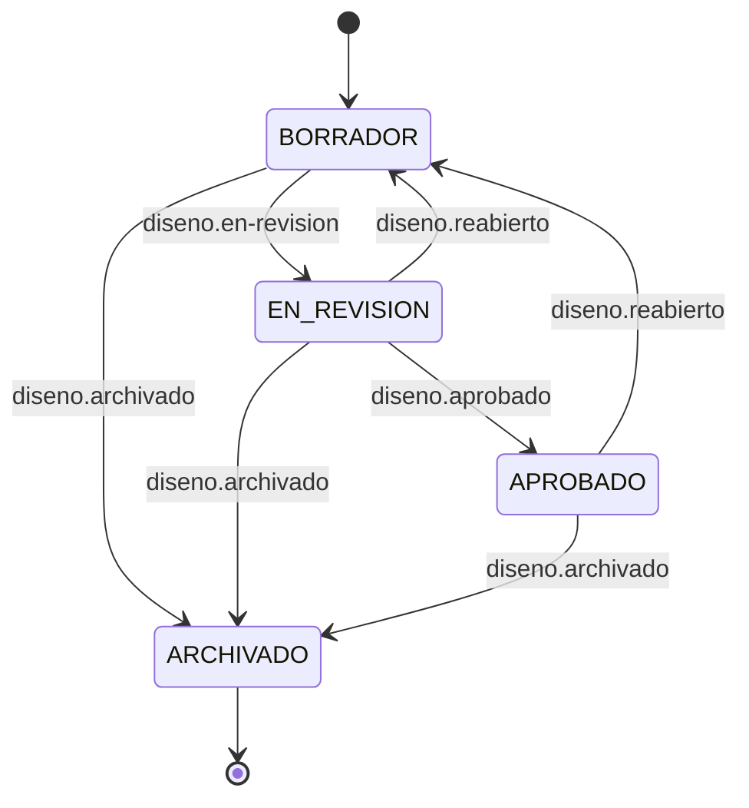
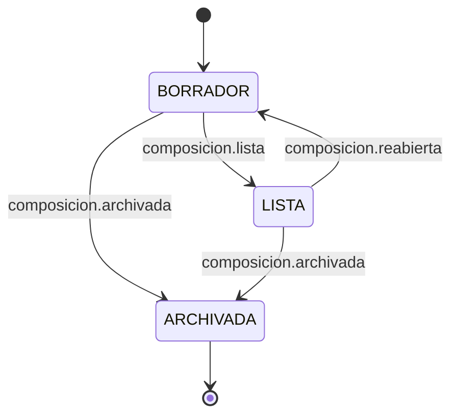

# Módulo: Diseños

Diseños por marca, artes importados de Illustrator, fuentes y composiciones (diseño aplicado a un modelo con técnica, acabado y capas).

## Entidades

### Diseno (`disenos`)
_alcance: global · borrado lógico · auditada_
Diseño de una marca, con una o varias composiciones.

| Campo | Tipo | Reglas | Por defecto |
| --- | --- | --- | --- |
| marcaId | `uuid` | requerido |  |
| nombre | `string(120)` | requerido |  |
| codigo | `slug(80)` | requerido, único |  |
| coleccion | `string(100)` |  |  |
| temporada | `string(40)` |  |  |
| estado | `enum {BORRADOR, EN_REVISION, APROBADO, ARCHIVADO}` |  | BORRADOR |
| etiquetas | `array` |  |  |
| miniatura | `image` |  |  |
| notas | `text` |  |  |
| ultimaActividadId | `uuid` |  |  |

#### Estados de Diseno (campo `estado`)
Estado inicial: `BORRADOR`. Solo se permiten estas transiciones.

| Desde | Hacia | Evento | Roles | Condición |
| --- | --- | --- | --- | --- |
| BORRADOR | EN_REVISION | diseno.en-revision | Propietario |  |
| EN_REVISION | APROBADO | diseno.aprobado | Propietario |  |
| EN_REVISION, APROBADO | BORRADOR | diseno.reabierto | Propietario |  |
| BORRADOR, EN_REVISION, APROBADO | ARCHIVADO | diseno.archivado | Propietario |  |

### Arte (`artes`)
_alcance: global · borrado lógico_
Archivo de arte importado (SVG, AI compatible con PDF, PDF o imagen).

| Campo | Tipo | Reglas | Por defecto |
| --- | --- | --- | --- |
| disenoId | `uuid` | requerido |  |
| nombre | `string(120)` | requerido |  |
| archivoOriginal | `file` | requerido |  |
| formato | `enum {SVG, AI_PDF, PDF, PNG, JPG, WEBP}` | requerido |  |
| esVectorial | `boolean` |  | false |
| anchoCm | `decimal(7,2)` |  |  |
| altoCm | `decimal(7,2)` |  |  |
| anchoPx | `int` |  |  |
| altoPx | `int` |  |  |
| dpi | `smallint` |  |  |
| coloresDetectados | `array` |  |  |
| numeroColores | `smallint` |  |  |
| vistaPrevia | `image` |  |  |
| hashSha256 | `char(64)` | requerido |  |
| ultimaActividadId | `uuid` |  |  |

Índices compuestos: `(hashSha256)`

### Fuente (`fuentes`)
_alcance: global_
Tipografías propias para capas de texto.

| Campo | Tipo | Reglas | Por defecto |
| --- | --- | --- | --- |
| nombre | `string(100)` | requerido |  |
| familia | `string(100)` | requerido |  |
| archivo | `file` | requerido |  |
| peso | `smallint` |  | 400 |
| estilo | `enum {NORMAL, ITALICA}` |  | NORMAL |
| ultimaActividadId | `uuid` |  |  |

### Composicion (`composiciones`)
_alcance: global · borrado lógico · auditada_
Diseño aplicado a un modelo de prenda con técnica, acabado, colores elegidos y capas por zona.

| Campo | Tipo | Reglas | Por defecto |
| --- | --- | --- | --- |
| disenoId | `uuid` | requerido |  |
| modeloPrendaId | `uuid` | requerido |  |
| nombre | `string(120)` | requerido |  |
| tecnica | `enum {SERIGRAFIA, DTF, BORDADO, VINIL, PUFF, DTG, SUBLIMACION}` | requerido |  |
| acabado | `enum {NINGUNO, ACID_WASH, VINTAGE, DESGASTADO, GARMENT_DYE}` |  | NINGUNO |
| intensidadAcabado | `percentage` |  | 50 |
| coloresSeleccionados | `array` |  |  |
| numeroZonas | `smallint` |  | 0 |
| numeroColores | `smallint` |  | 0 |
| numeroColoresManual | `boolean` |  | false |
| estado | `enum {BORRADOR, LISTA, ARCHIVADA}` |  | BORRADOR |
| miniatura | `image` |  |  |
| ultimaActividadId | `uuid` |  |  |

#### Estados de Composicion (campo `estado`)
Estado inicial: `BORRADOR`. Solo se permiten estas transiciones.

| Desde | Hacia | Evento | Roles | Condición |
| --- | --- | --- | --- | --- |
| BORRADOR | LISTA | composicion.lista | Propietario | capas visibles > 0 |
| LISTA | BORRADOR | composicion.reabierta | Propietario |  |
| BORRADOR, LISTA | ARCHIVADA | composicion.archivada | Propietario |  |

### CapaComposicion (`capas_composicion`)
_alcance: global_
Capa de arte, texto o forma en una zona; medidas en cm sobre el grupo de talla base.

| Campo | Tipo | Reglas | Por defecto |
| --- | --- | --- | --- |
| composicionId | `uuid` | requerido |  |
| zonaImpresionId | `uuid` | requerido |  |
| tipo | `enum {ARTE, TEXTO, FORMA}` | requerido |  |
| arteId | `uuid` |  |  |
| fuenteId | `uuid` |  |  |
| texto | `string(300)` |  |  |
| colorTexto | `color` |  |  |
| tintas | `array` |  |  |
| posXCm | `decimal(7,2)` |  | 0 |
| posYCm | `decimal(7,2)` |  | 0 |
| anchoCm | `decimal(7,2)` | requerido |  |
| altoCm | `decimal(7,2)` | requerido |  |
| rotacionGrados | `decimal(6,2)` |  | 0 |
| opacidad | `percentage` |  | 100 |
| modoFusion | `enum {NORMAL, MULTIPLICAR, PANTALLA, SUPERPONER, LUZ_SUAVE}` |  | NORMAL |
| orden | `smallint` |  | 0 |
| visible | `boolean` |  | true |
| bloqueada | `boolean` |  | false |
| grupoTallaBaseId | `uuid` |  |  |
| ajustesPorGrupoTalla | `json` |  |  |
| ultimaActividadId | `uuid` |  |  |

Índices compuestos: `(composicionId, orden)`

## Relaciones

- ContenidoGenerado.disenoId → `ManyToOne` → Diseno. (diseno)
- Diseno.ultimaActividadId → `ManyToOne` → Actividad. (ultimaActividad)
- Diseno.marcaId → `ManyToOne` → Marca. (marca)
- Arte.ultimaActividadId → `ManyToOne` → Actividad. (ultimaActividad)
- Arte.disenoId → `ManyToOne` → Diseno. (diseno)
- Fuente.ultimaActividadId → `ManyToOne` → Actividad. (ultimaActividad)
- Composicion.ultimaActividadId → `ManyToOne` → Actividad. (ultimaActividad)
- Composicion.disenoId → `ManyToOne` → Diseno. (diseno)
- Composicion.modeloPrendaId → `ManyToOne` → ModeloPrenda. (modelo)
- CapaComposicion.ultimaActividadId → `ManyToOne` → Actividad. (ultimaActividad)
- CapaComposicion.composicionId → `ManyToOne` → Composicion. (composicion)
- CapaComposicion.zonaImpresionId → `ManyToOne` → ZonaImpresion. (zona)
- CapaComposicion.arteId → `ManyToOne` → Arte. (arte)
- CapaComposicion.fuenteId → `ManyToOne` → Fuente. (fuente)
- CapaComposicion.grupoTallaBaseId → `ManyToOne` → GrupoTalla. (grupoTallaBase)
- LoteItem.composicionId → `ManyToOne` → Composicion. (composicion)
- ArchivoProduccion.composicionId → `ManyToOne` → Composicion. (composicion)
- PaqueteProduccion.composicionId → `ManyToOne` → Composicion. (composicion)
- CotizacionCosto.disenoId → `ManyToOne` → Diseno. (diseno)
- CotizacionCosto.composicionId → `ManyToOne` → Composicion. (composicion)

## API

| Método | Ruta | Auth | Roles | Descripción |
| --- | --- | --- | --- | --- |
| `GET` | `/api/disenos` | sí |  |  |
| `POST` | `/api/disenos` | sí |  |  |
| `GET` | `/api/disenos/{id}` | sí |  |  |
| `PUT` | `/api/disenos/{id}` | sí |  |  |
| `POST` | `/api/disenos/{id}/{accion}` | sí |  | enviarRevision, aprobar, regresarBorrador, archivar |
| `POST` | `/api/disenos/{id}/artes` | sí |  | Multipart SVG, AI, PDF o imagen; analiza medidas y tintas |
| `GET` | `/api/artes/{id}/archivo` | sí |  |  |
| `DELETE` | `/api/artes/{id}` | sí |  |  |
| `POST` | `/api/disenos/{id}/composiciones` | sí |  |  |
| `GET` | `/api/composiciones/{id}` | sí |  | Incluye capas, modelo, zonas, áreas y bases listas |
| `PUT` | `/api/composiciones/{id}` | sí |  | Guarda composición y todas sus capas en una transacción |
| `POST` | `/api/composiciones/{id}/duplicar` | sí |  | Opcionalmente a otro modelo de prenda |
| `POST` | `/api/composiciones/{id}/{accion}` | sí |  |  |
| `GET` | `/api/fuentes` | sí |  |  |
| `POST` | `/api/fuentes` | sí |  |  |

## Pantallas

| Pantalla | Tipo | Ruta | Entidad | Roles |
| --- | --- | --- | --- | --- |
| Diseños | List | `/disenos` | Diseno |  |
| Diseño | Detail | `/disenos/:id` | Diseno |  |
| Editor de mockup | Editor | `/disenos/:id/composiciones/:cid` | Composicion |  |
| Fuentes | List | `/disenos/fuentes` | Fuente |  |

## Eventos

| Evento | Se emite cuando | Payload |
| --- | --- | --- |
| `arte.importado` | on_create |  |
| `composicion.actualizada` | on_update |  |
| `diseno.aprobado` | on_state_change |  |

## Reportes

| Reporte | Entidad | Columnas | Filtros |
| --- | --- | --- | --- |
| Diseños por colección | Diseno | nombre, codigo, coleccion, temporada, estado | marcaId, coleccion, estado |
| Composiciones por técnica | Composicion | nombre, tecnica, acabado, numeroZonas, numeroColores, estado | tecnica, modeloPrendaId, estado |

## Dashboards

| Widget | Tipo | Fuente |
| --- | --- | --- |
| Diseños activos | kpi | disenos.diseno |

## Criterios de aceptación

- [ ] CRUD de Diseno con validación de campos requeridos y únicos.
- [ ] Diseno: el borrado es lógico (`deleted_at`) y las consultas excluyen lo borrado.
- [ ] Diseno: cada cambio registra quién, qué y cuándo.
- [ ] Diseno: solo las 4 transiciones del diagrama son válidas; las demás se rechazan con 409.
- [ ] Diseno: cada transición verifica el rol permitido y emite su evento.
- [ ] CRUD de Arte con validación de campos requeridos y únicos.
- [ ] Arte: el borrado es lógico (`deleted_at`) y las consultas excluyen lo borrado.
- [ ] CRUD de Fuente con validación de campos requeridos y únicos.
- [ ] CRUD de Composicion con validación de campos requeridos y únicos.
- [ ] Composicion: el borrado es lógico (`deleted_at`) y las consultas excluyen lo borrado.
- [ ] Composicion: cada cambio registra quién, qué y cuándo.
- [ ] Composicion: solo las 3 transiciones del diagrama son válidas; las demás se rechazan con 409.
- [ ] Composicion: cada transición verifica el rol permitido y emite su evento.
- [ ] CRUD de CapaComposicion con validación de campos requeridos y únicos.
- [ ] Todas las rutas del apartado API existen con el método y la autenticación indicados.
- [ ] Cada pantalla respeta los roles requeridos y define estados de carga, vacío y error.
- [ ] Los eventos se emiten con el payload indicado, de forma idempotente.
- [ ] Tests del módulo y type-check sin errores.

## Dónde trabajar
- Web: `apps/web/src/features/disenos/`
