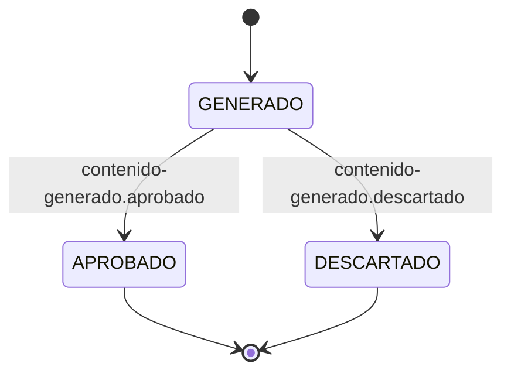

# Módulo: Inteligencia artificial

Plantillas de prompts, consumo y costo de Anthropic y Gemini, y contenido de texto generado.

## Entidades

### PromptPlantilla (`prompt_plantillas`)
_alcance: global · auditada_
Prompts versionados y editables por operación.

| Campo | Tipo | Reglas | Por defecto |
| --- | --- | --- | --- |
| clave | `slug(80)` | requerido, único |  |
| nombre | `string(120)` | requerido |  |
| proveedor | `enum {ANTHROPIC, GEMINI}` | requerido |  |
| modelo | `string(80)` | requerido |  |
| tipo | `enum {ANALIZAR_BASE, DETECTAR_ZONAS, REVISAR_CALIDAD, LIMPIAR_BASE, ENDEREZAR_PRENDA, GENERAR_BASE, GENERAR_ESCENA, GENERAR_COPY}` | requerido |  |
| prompt | `text` | requerido |  |
| esquemaSalida | `json` |  |  |
| temperatura | `decimal(3,2)` |  | 0.2 |
| version | `smallint` |  | 1 |
| activa | `boolean` |  | true |
| ultimaActividadId | `uuid` |  |  |

### ConsumoIa (`consumos_ia`)
_alcance: global_
Registro de cada llamada a IA con costo estimado.

| Campo | Tipo | Reglas | Por defecto |
| --- | --- | --- | --- |
| proveedor | `enum {ANTHROPIC, GEMINI}` | requerido |  |
| modelo | `string(80)` | requerido |  |
| operacion | `enum {ANALIZAR_BASE, DETECTAR_ZONAS, REVISAR_CALIDAD, LIMPIAR_BASE, ENDEREZAR_PRENDA, GENERAR_BASE, GENERAR_ESCENA, GENERAR_COPY}` | requerido |  |
| promptPlantillaId | `uuid` |  |  |
| trabajoId | `uuid` |  |  |
| tokensEntrada | `int` |  | 0 |
| tokensSalida | `int` |  | 0 |
| imagenesEntrada | `smallint` |  | 0 |
| imagenesSalida | `smallint` |  | 0 |
| costoEstimadoUsd | `decimal(10,4)` |  | 0 |
| duracionMs | `int` |  |  |
| exitoso | `boolean` |  | true |
| error | `text` |  |  |
| ultimaActividadId | `uuid` |  |  |

Índices compuestos: `(proveedor, operacion)`

### ContenidoGenerado (`contenidos_generados`)
_alcance: global_
Nombres, descripciones, copys y hashtags generados con Claude (fase 2).

| Campo | Tipo | Reglas | Por defecto |
| --- | --- | --- | --- |
| marcaId | `uuid` | requerido |  |
| disenoId | `uuid` |  |  |
| tipo | `enum {NOMBRE_PRODUCTO, DESCRIPCION_TIENDA, COPY_INSTAGRAM, HASHTAGS, TEXTO_ALT}` | requerido |  |
| texto | `text` | requerido |  |
| estado | `enum {GENERADO, APROBADO, DESCARTADO}` |  | GENERADO |
| consumoIaId | `uuid` |  |  |
| ultimaActividadId | `uuid` |  |  |

#### Estados de ContenidoGenerado (campo `estado`)
Estado inicial: `GENERADO`. Solo se permiten estas transiciones.

| Desde | Hacia | Evento | Roles | Condición |
| --- | --- | --- | --- | --- |
| GENERADO | APROBADO | contenido-generado.aprobado | Propietario |  |
| GENERADO | DESCARTADO | contenido-generado.descartado | Propietario |  |

## Relaciones

- PromptPlantilla.ultimaActividadId → `ManyToOne` → Actividad. (ultimaActividad)
- ConsumoIa.ultimaActividadId → `ManyToOne` → Actividad. (ultimaActividad)
- ConsumoIa.promptPlantillaId → `ManyToOne` → PromptPlantilla. (plantilla)
- ConsumoIa.trabajoId → `ManyToOne` → Trabajo. (trabajo)
- ContenidoGenerado.ultimaActividadId → `ManyToOne` → Actividad. (ultimaActividad)
- ContenidoGenerado.marcaId → `ManyToOne` → Marca. (marca)
- ContenidoGenerado.disenoId → `ManyToOne` → Diseno. (diseno)
- ContenidoGenerado.consumoIaId → `ManyToOne` → ConsumoIa. (consumo)

## API

| Método | Ruta | Auth | Roles | Descripción |
| --- | --- | --- | --- | --- |
| `GET` | `/api/ia/prompts` | sí |  |  |
| `PUT` | `/api/ia/prompts/{id}` | sí |  | Incrementa versión |
| `POST` | `/api/ia/prompts/{id}/probar` | sí |  |  |
| `POST` | `/api/ia/estimar` | sí |  | Devuelve costo estimado antes de ejecutar una operación |
| `GET` | `/api/ia/consumo` | sí |  |  |
| `POST` | `/api/ia/disenos/{disenoId}/copys` | sí |  |  |
| `POST` | `/api/ia/contenido/{id}/aprobar` | sí |  |  |
| `POST` | `/api/ia/contenido/{id}/descartar` | sí |  |  |

## Pantallas

| Pantalla | Tipo | Ruta | Entidad | Roles |
| --- | --- | --- | --- | --- |
| Prompts | List | `/ia/prompts` | PromptPlantilla |  |
| Prompt | Form | `/ia/prompts/:id` | PromptPlantilla |  |
| Consumo de IA | Report | `/ia/consumo` | ConsumoIa |  |
| Contenido generado | List | `/ia/contenido` | ContenidoGenerado |  |

## Eventos

| Evento | Se emite cuando | Payload |
| --- | --- | --- |
| `consumo-ia.registrado` | on_create |  |

## Reportes

| Reporte | Entidad | Columnas | Filtros |
| --- | --- | --- | --- |
| Gasto de IA por proveedor | ConsumoIa | proveedor, modelo, operacion, tokensEntrada, tokensSalida, imagenesSalida, costoEstimadoUsd | proveedor, operacion, modelo |
| Llamadas fallidas | ConsumoIa | proveedor, operacion, error, duracionMs | proveedor |

## Criterios de aceptación

- [ ] CRUD de PromptPlantilla con validación de campos requeridos y únicos.
- [ ] PromptPlantilla: cada cambio registra quién, qué y cuándo.
- [ ] CRUD de ConsumoIa con validación de campos requeridos y únicos.
- [ ] CRUD de ContenidoGenerado con validación de campos requeridos y únicos.
- [ ] ContenidoGenerado: solo las 2 transiciones del diagrama son válidas; las demás se rechazan con 409.
- [ ] ContenidoGenerado: cada transición verifica el rol permitido y emite su evento.
- [ ] Todas las rutas del apartado API existen con el método y la autenticación indicados.
- [ ] Cada pantalla respeta los roles requeridos y define estados de carga, vacío y error.
- [ ] Los eventos se emiten con el payload indicado, de forma idempotente.
- [ ] Tests del módulo y type-check sin errores.

## Dónde trabajar
- Web: `apps/web/src/features/ia/`
