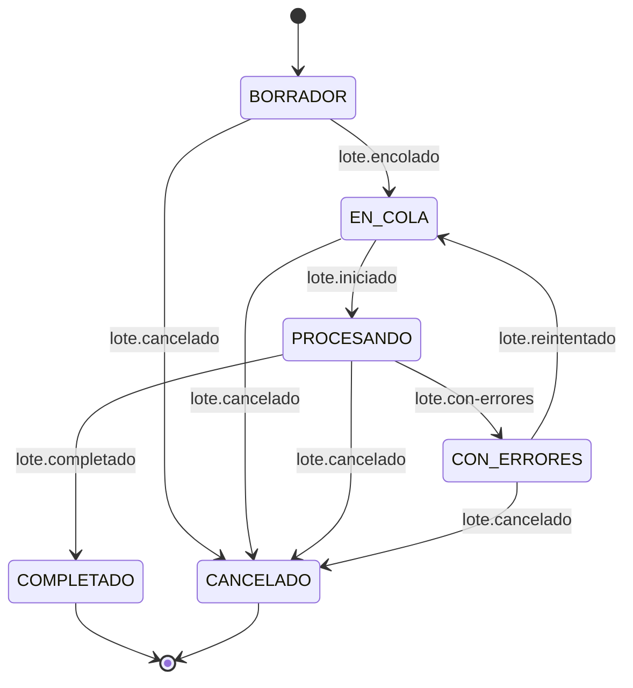
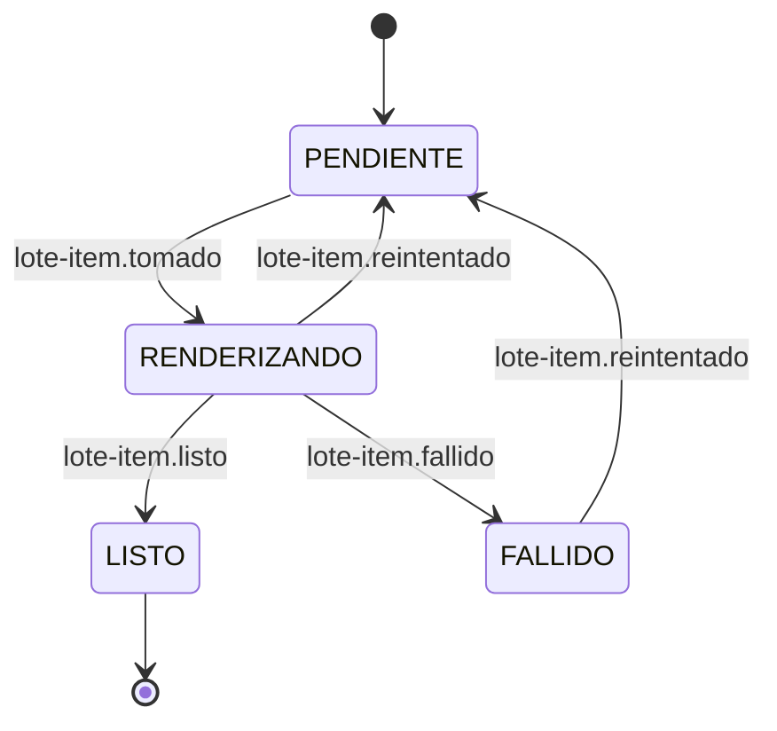

# Módulo: Mockups y lotes

Perfiles de exportación, lotes automáticos (composiciones x colores x vistas x escenas x perfiles) y galería de resultados.

## Entidades

### PerfilExportacion (`perfiles_exportacion`)
_alcance: global_
Formato de salida (Instagram, tienda, transparente, GIF o video 360).

| Campo | Tipo | Reglas | Por defecto |
| --- | --- | --- | --- |
| nombre | `string(80)` | requerido, único |  |
| motor | `enum {MOCKUP_2D, MOCKUP_3D}` |  | MOCKUP_2D |
| tipoSalida | `enum {IMAGEN, GIF, VIDEO_MP4}` |  | IMAGEN |
| formato | `enum {PNG, JPG, WEBP, GIF, MP4}` |  | PNG |
| anchoPx | `int` | requerido |  |
| altoPx | `int` | requerido |  |
| fondoTransparente | `boolean` |  | false |
| calidad | `smallint` | mín 1, máx 100 | 92 |
| escenaId | `uuid` |  |  |
| patronNombre | `string(200)` |  | {marca}_{diseno}_{modelo}_{color}_{vista}_{perfil} |
| duracionSeg | `smallint` |  |  |
| fps | `smallint` |  |  |
| activo | `boolean` |  | true |
| ultimaActividadId | `uuid` |  |  |

### Lote (`lotes`)
_alcance: global · auditada_
Generación masiva de mockups.

| Campo | Tipo | Reglas | Por defecto |
| --- | --- | --- | --- |
| marcaId | `uuid` | requerido |  |
| nombre | `string(150)` | requerido |  |
| estado | `enum {BORRADOR, EN_COLA, PROCESANDO, COMPLETADO, CON_ERRORES, CANCELADO}` |  | BORRADOR |
| configuracion | `json` |  |  |
| totalItems | `int` |  | 0 |
| itemsListos | `int` |  | 0 |
| itemsFallidos | `int` |  | 0 |
| archivoZip | `file` |  |  |
| iniciadoEn | `datetime` |  |  |
| terminadoEn | `datetime` |  |  |
| ultimaActividadId | `uuid` |  |  |

#### Estados de Lote (campo `estado`)
Estado inicial: `BORRADOR`. Solo se permiten estas transiciones.

| Desde | Hacia | Evento | Roles | Condición |
| --- | --- | --- | --- | --- |
| BORRADOR | EN_COLA | lote.encolado | Propietario | totalItems > 0 |
| EN_COLA | PROCESANDO | lote.iniciado |  |  |
| PROCESANDO | COMPLETADO | lote.completado |  | itemsFallidos == 0 |
| PROCESANDO | CON_ERRORES | lote.con-errores |  |  |
| CON_ERRORES | EN_COLA | lote.reintentado | Propietario |  |
| BORRADOR, EN_COLA, PROCESANDO, CON_ERRORES | CANCELADO | lote.cancelado | Propietario |  |

### LoteItem (`lote_items`)
_alcance: global_
Un mockup a renderizar dentro de un lote.

| Campo | Tipo | Reglas | Por defecto |
| --- | --- | --- | --- |
| loteId | `uuid` | requerido |  |
| composicionId | `uuid` | requerido |  |
| baseMockupId | `uuid` | requerido |  |
| colorPrendaId | `uuid` | requerido |  |
| escenaId | `uuid` |  |  |
| perfilExportacionId | `uuid` | requerido |  |
| nombreArchivo | `string(250)` | requerido |  |
| estado | `enum {PENDIENTE, RENDERIZANDO, LISTO, FALLIDO}` |  | PENDIENTE |
| archivo | `file` |  |  |
| miniatura | `image` |  |  |
| error | `text` |  |  |
| duracionMs | `int` |  |  |
| favorito | `boolean` |  | false |
| ultimaActividadId | `uuid` |  |  |

Índices compuestos: `(loteId, estado)`

#### Estados de LoteItem (campo `estado`)
Estado inicial: `PENDIENTE`. Solo se permiten estas transiciones.

| Desde | Hacia | Evento | Roles | Condición |
| --- | --- | --- | --- | --- |
| PENDIENTE | RENDERIZANDO | lote-item.tomado |  |  |
| RENDERIZANDO | LISTO | lote-item.listo |  |  |
| RENDERIZANDO | FALLIDO | lote-item.fallido |  |  |
| FALLIDO, RENDERIZANDO | PENDIENTE | lote-item.reintentado |  |  |

## Relaciones

- PerfilExportacion.ultimaActividadId → `ManyToOne` → Actividad. (ultimaActividad)
- PerfilExportacion.escenaId → `ManyToOne` → Escena. (escena)
- Lote.ultimaActividadId → `ManyToOne` → Actividad. (ultimaActividad)
- Lote.marcaId → `ManyToOne` → Marca. (marca)
- LoteItem.ultimaActividadId → `ManyToOne` → Actividad. (ultimaActividad)
- LoteItem.loteId → `ManyToOne` → Lote. (lote)
- LoteItem.composicionId → `ManyToOne` → Composicion. (composicion)
- LoteItem.baseMockupId → `ManyToOne` → BaseMockup. (base)
- LoteItem.colorPrendaId → `ManyToOne` → ColorPrenda. (color)
- LoteItem.escenaId → `ManyToOne` → Escena. (escena)
- LoteItem.perfilExportacionId → `ManyToOne` → PerfilExportacion. (perfil)

## API

| Método | Ruta | Auth | Roles | Descripción |
| --- | --- | --- | --- | --- |
| `GET` | `/api/perfiles-exportacion` | sí |  |  |
| `PUT` | `/api/perfiles-exportacion/{id}` | sí |  |  |
| `POST` | `/api/lotes/previsualizar` | sí |  | Devuelve combinaciones y total sin crear |
| `POST` | `/api/lotes` | sí |  | Expande combinaciones a LoteItem |
| `GET` | `/api/lotes` | sí |  |  |
| `GET` | `/api/lotes/{id}` | sí |  |  |
| `POST` | `/api/lotes/{id}/encolar` | sí |  |  |
| `POST` | `/api/lotes/{id}/siguiente` | sí |  | El worker del frontend toma el siguiente PENDIENTE con todo lo necesario para renderizar |
| `PUT` | `/api/lote-items/{id}/resultado` | sí |  | Multipart con la imagen renderizada |
| `POST` | `/api/lote-items/{id}/fallo` | sí |  |  |
| `POST` | `/api/lotes/{id}/reintentar` | sí |  |  |
| `POST` | `/api/lotes/{id}/cancelar` | sí |  |  |
| `GET` | `/api/lotes/{id}/zip` | sí |  |  |
| `PATCH` | `/api/lote-items/{id}` | sí |  |  |
| `POST` | `/api/mockups/rapido` | sí |  | Crea un lote de un solo item desde el editor |

## Pantallas

| Pantalla | Tipo | Ruta | Entidad | Roles |
| --- | --- | --- | --- | --- |
| Lotes | List | `/mockups/lotes` | Lote |  |
| Nuevo lote | Wizard | `/mockups/lotes/nuevo` | Lote |  |
| Lote | Detail | `/mockups/lotes/:id` | Lote |  |
| Galería | List | `/mockups/galeria` | LoteItem |  |
| Perfiles de exportación | List | `/mockups/perfiles` | PerfilExportacion |  |
| Perfil de exportación | Form | `/mockups/perfiles/:id` | PerfilExportacion |  |

## Workflows

### Render de lote
El frontend renderiza item por item y el backend empaqueta.
Se dispara con: `lote.encolado`

1. [trigger] Lote encolado
2. [action] Iniciar lote
3. [loop] Por cada item pendiente
4. [script] Renderizar en Web Worker
5. [action] Guardar resultado
6. [condition] ¿Hubo fallidos?
7. [action] Armar ZIP
8. [notification] Avisar lote terminado
9. [end] Fin

## Eventos

| Evento | Se emite cuando | Payload |
| --- | --- | --- |
| `lote.encolado` | on_state_change |  |
| `lote.completado` | on_state_change |  |
| `lote.con-errores` | on_state_change |  |
| `lote-item.listo` | on_state_change |  |
| `lote-item.fallido` | on_state_change |  |

## Reportes

| Reporte | Entidad | Columnas | Filtros |
| --- | --- | --- | --- |
| Lotes | Lote | nombre, estado, totalItems, itemsListos, itemsFallidos, terminadoEn | marcaId, estado |
| Mockups favoritos | LoteItem | nombreArchivo, composicionId, colorPrendaId, perfilExportacionId | composicionId, colorPrendaId |

## Dashboards

| Widget | Tipo | Fuente |
| --- | --- | --- |
| Mockups generados este mes | kpi | mockups.lote-item |
| Lotes por estado | bar | mockups.lote |

## Criterios de aceptación

- [ ] CRUD de PerfilExportacion con validación de campos requeridos y únicos.
- [ ] CRUD de Lote con validación de campos requeridos y únicos.
- [ ] Lote: cada cambio registra quién, qué y cuándo.
- [ ] Lote: solo las 6 transiciones del diagrama son válidas; las demás se rechazan con 409.
- [ ] Lote: cada transición verifica el rol permitido y emite su evento.
- [ ] CRUD de LoteItem con validación de campos requeridos y únicos.
- [ ] LoteItem: solo las 4 transiciones del diagrama son válidas; las demás se rechazan con 409.
- [ ] LoteItem: cada transición verifica el rol permitido y emite su evento.
- [ ] Todas las rutas del apartado API existen con el método y la autenticación indicados.
- [ ] Cada pantalla respeta los roles requeridos y define estados de carga, vacío y error.
- [ ] Workflow "Render de lote": probar cada transición y los casos de rechazo.
- [ ] Los eventos se emiten con el payload indicado, de forma idempotente.
- [ ] Tests del módulo y type-check sin errores.

## Dónde trabajar
- Web: `apps/web/src/features/mockups/`
