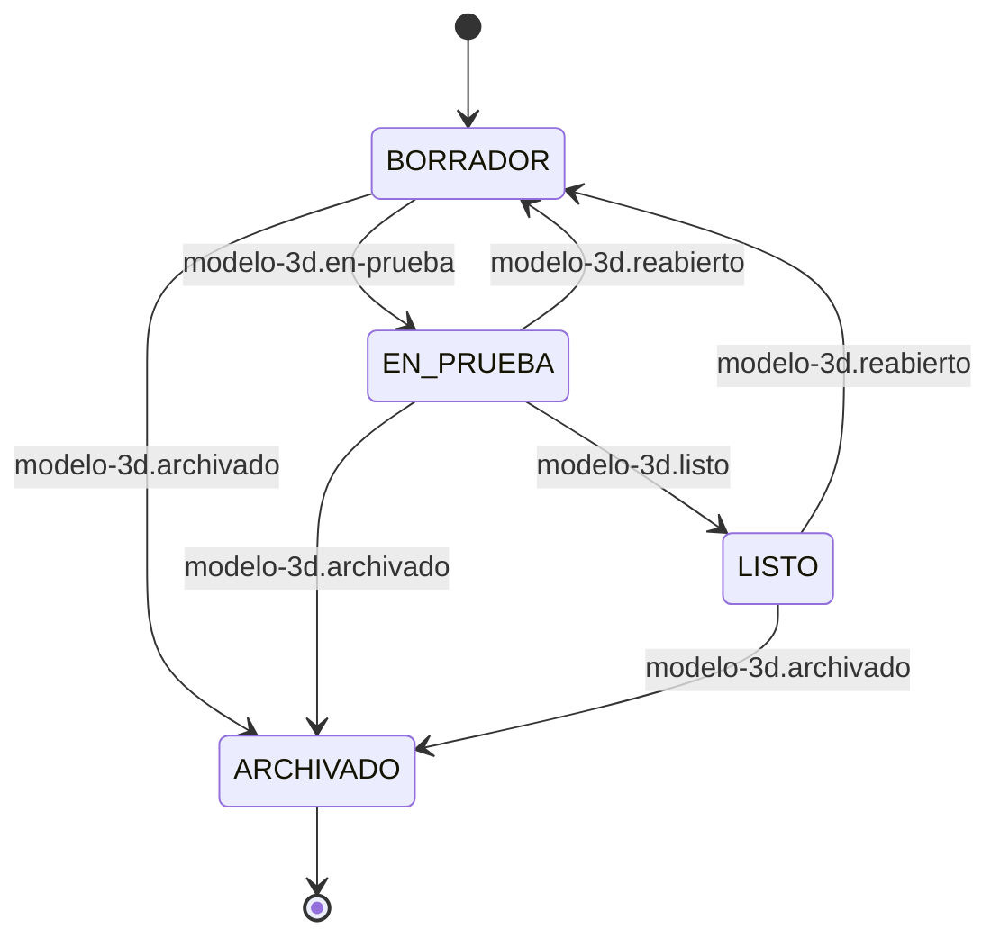

# Módulo: Modelos 3D

Fase 2: modelos .glb por prenda hechos en Marvelous Designer, piezas del patrón de corte y materiales de tela para el visor 3D, GIF y video 360.

## Entidades

### Modelo3d (`modelos_3d`)
_alcance: global · borrado lógico_
Modelo 3D con UV de un modelo de prenda.

| Campo | Tipo | Reglas | Por defecto |
| --- | --- | --- | --- |
| modeloPrendaId | `uuid` | requerido |  |
| version | `string(20)` | requerido |  |
| fuente | `enum {MARVELOUS_DESIGNER, CLO3D, COMPRADO, OTRO}` | requerido |  |
| archivoGlb | `file` | requerido |  |
| archivoFuente | `file` |  |  |
| escalaCm | `decimal(8,4)` |  | 1 |
| estado | `enum {BORRADOR, EN_PRUEBA, LISTO, ARCHIVADO}` |  | BORRADOR |
| notas | `text` |  |  |
| ultimaActividadId | `uuid` |  |  |

#### Estados de Modelo3d (campo `estado`)
Estado inicial: `BORRADOR`. Solo se permiten estas transiciones.

| Desde | Hacia | Evento | Roles | Condición |
| --- | --- | --- | --- | --- |
| BORRADOR | EN_PRUEBA | modelo-3d.en-prueba | Propietario | UV válido y piezas mapeadas |
| EN_PRUEBA | LISTO | modelo-3d.listo | Propietario |  |
| EN_PRUEBA, LISTO | BORRADOR | modelo-3d.reabierto | Propietario |  |
| BORRADOR, EN_PRUEBA, LISTO | ARCHIVADO | modelo-3d.archivado | Propietario |  |

### PiezaPatron (`piezas_patron`)
_alcance: global_
Pieza del patrón de corte con su región UV.

| Campo | Tipo | Reglas | Por defecto |
| --- | --- | --- | --- |
| modelo3dId | `uuid` | requerido |  |
| nombre | `string(80)` | requerido |  |
| zonaImpresionId | `uuid` |  |  |
| anchoCm | `decimal(7,2)` |  |  |
| altoCm | `decimal(7,2)` |  |  |
| cortes | `smallint` |  | 1 |
| regionUv | `json` | requerido |  |
| ultimaActividadId | `uuid` |  |  |

### MaterialTela (`materiales_tela`)
_alcance: global_
Textura y parámetros de tela para render 3D.

| Campo | Tipo | Reglas | Por defecto |
| --- | --- | --- | --- |
| nombre | `string(80)` | requerido |  |
| tipo | `enum {ALGODON, POLIESTER, MEZCLA, FELPA, JASPEADO, GARMENT_DYE}` | requerido |  |
| mapaNormal | `image` |  |  |
| rugosidad | `decimal(4,2)` |  | 0.8 |
| tamanoTejido | `decimal(5,2)` |  | 3 |
| arrugas | `decimal(4,2)` |  | 0.5 |
| ultimaActividadId | `uuid` |  |  |

## Relaciones

- Modelo3d.ultimaActividadId → `ManyToOne` → Actividad. (ultimaActividad)
- Modelo3d.modeloPrendaId → `ManyToOne` → ModeloPrenda. (modelo)
- PiezaPatron.ultimaActividadId → `ManyToOne` → Actividad. (ultimaActividad)
- PiezaPatron.modelo3dId → `ManyToOne` → Modelo3d. (modelo3d)
- PiezaPatron.zonaImpresionId → `ManyToOne` → ZonaImpresion. (zona)
- MaterialTela.ultimaActividadId → `ManyToOne` → Actividad. (ultimaActividad)

## API

| Método | Ruta | Auth | Roles | Descripción |
| --- | --- | --- | --- | --- |
| `GET` | `/api/modelos-3d` | sí |  |  |
| `POST` | `/api/modelos-3d` | sí |  | Multipart .glb; extrae piezas y UV |
| `POST` | `/api/modelos-3d/{id}/validar` | sí |  |  |
| `POST` | `/api/modelos-3d/{id}/{accion}` | sí |  |  |
| `PUT` | `/api/modelos-3d/{id}/piezas` | sí |  |  |
| `GET` | `/api/modelos-3d/{id}/patron.pdf` | sí |  |  |
| `GET` | `/api/materiales-tela` | sí |  |  |
| `PUT` | `/api/materiales-tela/{id}` | sí |  |  |

## Pantallas

| Pantalla | Tipo | Ruta | Entidad | Roles |
| --- | --- | --- | --- | --- |
| Modelos 3D | List | `/modelos-3d` | Modelo3d |  |
| Visor 3D | custom:Visor3D | `/modelos-3d/:id` | Modelo3d |  |
| Patrón de corte | Detail | `/modelos-3d/:id/patron` | PiezaPatron |  |
| Materiales de tela | List | `/modelos-3d/materiales` | MaterialTela |  |

## Eventos

| Evento | Se emite cuando | Payload |
| --- | --- | --- |
| `modelo-3d.listo` | on_state_change |  |

## Reportes

| Reporte | Entidad | Columnas | Filtros |
| --- | --- | --- | --- |
| Modelos 3D por prenda | Modelo3d | modeloPrendaId, version, fuente, estado | estado, fuente |

## Criterios de aceptación

- [ ] CRUD de Modelo3d con validación de campos requeridos y únicos.
- [ ] Modelo3d: el borrado es lógico (`deleted_at`) y las consultas excluyen lo borrado.
- [ ] Modelo3d: solo las 4 transiciones del diagrama son válidas; las demás se rechazan con 409.
- [ ] Modelo3d: cada transición verifica el rol permitido y emite su evento.
- [ ] CRUD de PiezaPatron con validación de campos requeridos y únicos.
- [ ] CRUD de MaterialTela con validación de campos requeridos y únicos.
- [ ] Todas las rutas del apartado API existen con el método y la autenticación indicados.
- [ ] Cada pantalla respeta los roles requeridos y define estados de carga, vacío y error.
- [ ] Los eventos se emiten con el payload indicado, de forma idempotente.
- [ ] Tests del módulo y type-check sin errores.

## Dónde trabajar
- Web: `apps/web/src/features/modelos-3d/`
