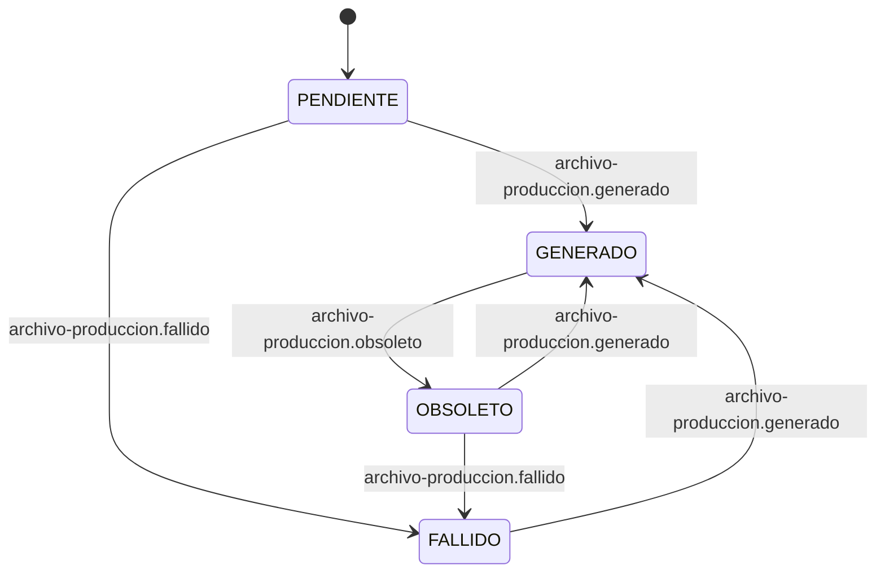
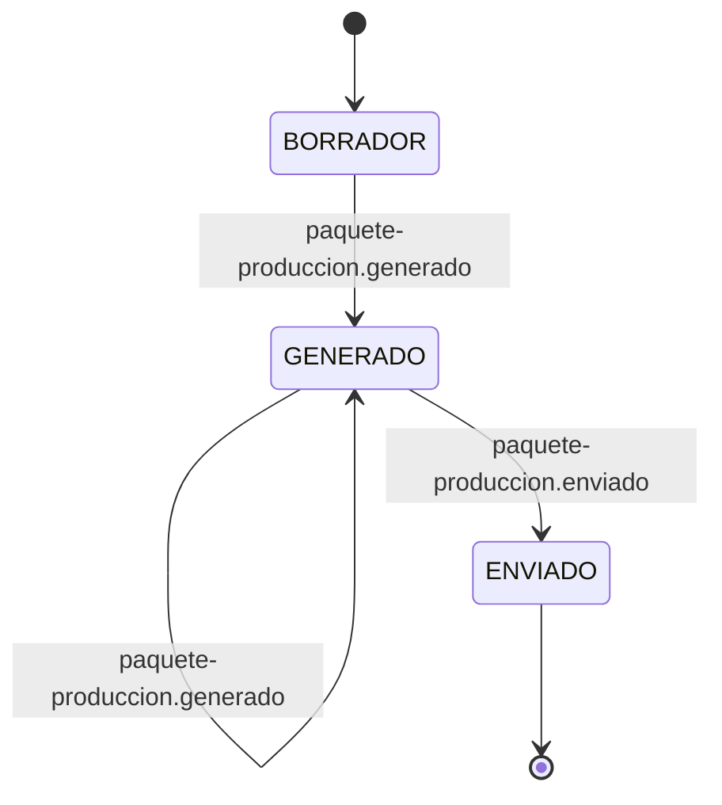

# Módulo: Producción

Archivos de producción por zona y grupo de talla y paquetes para el maquilador.

## Entidades

### ArchivoProduccion (`archivos_produccion`)
_alcance: global_
Arte a tamaño real por zona y grupo de talla.

| Campo | Tipo | Reglas | Por defecto |
| --- | --- | --- | --- |
| composicionId | `uuid` | requerido |  |
| zonaImpresionId | `uuid` | requerido |  |
| grupoTallaId | `uuid` | requerido |  |
| formato | `enum {PDF_VECTORIAL, PNG_300DPI, SVG}` | requerido |  |
| anchoCm | `decimal(7,2)` |  |  |
| altoCm | `decimal(7,2)` |  |  |
| dpi | `smallint` |  | 300 |
| archivo | `file` |  |  |
| hashSha256 | `char(64)` |  |  |
| estado | `enum {PENDIENTE, GENERADO, FALLIDO, OBSOLETO}` |  | PENDIENTE |
| error | `text` |  |  |
| generadoEn | `datetime` |  |  |
| ultimaActividadId | `uuid` |  |  |

Índices compuestos: `(composicionId, zonaImpresionId, grupoTallaId, formato)` único

#### Estados de ArchivoProduccion (campo `estado`)
Estado inicial: `PENDIENTE`. Solo se permiten estas transiciones.

| Desde | Hacia | Evento | Roles | Condición |
| --- | --- | --- | --- | --- |
| PENDIENTE, OBSOLETO, FALLIDO | GENERADO | archivo-produccion.generado |  |  |
| PENDIENTE, OBSOLETO | FALLIDO | archivo-produccion.fallido |  |  |
| GENERADO | OBSOLETO | archivo-produccion.obsoleto |  | La composición cambió |

### PaqueteProduccion (`paquetes_produccion`)
_alcance: global_
ZIP para el maquilador con archivos, mockups de referencia y ficha.

| Campo | Tipo | Reglas | Por defecto |
| --- | --- | --- | --- |
| composicionId | `uuid` | requerido |  |
| cotizacionCostoId | `uuid` |  |  |
| nombre | `string(150)` | requerido |  |
| incluyeMockups | `boolean` |  | true |
| notasMaquilador | `text` |  |  |
| fichaPdf | `file` |  |  |
| archivoZip | `file` |  |  |
| estado | `enum {BORRADOR, GENERADO, ENVIADO}` |  | BORRADOR |
| enviadoEn | `datetime` |  |  |
| ultimaActividadId | `uuid` |  |  |

#### Estados de PaqueteProduccion (campo `estado`)
Estado inicial: `BORRADOR`. Solo se permiten estas transiciones.

| Desde | Hacia | Evento | Roles | Condición |
| --- | --- | --- | --- | --- |
| BORRADOR, GENERADO | GENERADO | paquete-produccion.generado | Propietario |  |
| GENERADO | ENVIADO | paquete-produccion.enviado | Propietario |  |

## Relaciones

- ArchivoProduccion.ultimaActividadId → `ManyToOne` → Actividad. (ultimaActividad)
- ArchivoProduccion.composicionId → `ManyToOne` → Composicion. (composicion)
- ArchivoProduccion.zonaImpresionId → `ManyToOne` → ZonaImpresion. (zona)
- ArchivoProduccion.grupoTallaId → `ManyToOne` → GrupoTalla. (grupoTalla)
- PaqueteProduccion.ultimaActividadId → `ManyToOne` → Actividad. (ultimaActividad)
- PaqueteProduccion.composicionId → `ManyToOne` → Composicion. (composicion)
- PaqueteProduccion.cotizacionCostoId → `ManyToOne` → CotizacionCosto. (cotizacion)

## API

| Método | Ruta | Auth | Roles | Descripción |
| --- | --- | --- | --- | --- |
| `POST` | `/api/composiciones/{id}/archivos-produccion` | sí |  | Por zona, grupo de talla y formatos elegidos |
| `GET` | `/api/composiciones/{id}/archivos-produccion` | sí |  |  |
| `GET` | `/api/archivos-produccion/{id}/descargar` | sí |  |  |
| `POST` | `/api/paquetes-produccion` | sí |  |  |
| `POST` | `/api/paquetes-produccion/{id}/generar` | sí |  |  |
| `POST` | `/api/paquetes-produccion/{id}/enviado` | sí |  |  |
| `GET` | `/api/paquetes-produccion/{id}/zip` | sí |  |  |

## Pantallas

| Pantalla | Tipo | Ruta | Entidad | Roles |
| --- | --- | --- | --- | --- |
| Archivos de producción | List | `/produccion/archivos` | ArchivoProduccion |  |
| Paquetes | List | `/produccion/paquetes` | PaqueteProduccion |  |
| Paquete | Detail | `/produccion/paquetes/:id` | PaqueteProduccion |  |

## Workflows

### Generar archivos de producción
Escala cada capa por grupo de talla y exporta en el formato adecuado.
Se dispara con: `manual`

1. [trigger] Solicitud manual
2. [loop] Por zona y grupo de talla
3. [condition] ¿Cabe en el área máxima?
4. [condition] ¿Todas las capas son vectoriales?
5. [action] Exportar PDF vectorial
6. [action] Exportar PNG 300 DPI
7. [notification] Avisar que excede el área
8. [end] Fin

## Eventos

| Evento | Se emite cuando | Payload |
| --- | --- | --- |
| `archivo-produccion.obsoleto` | on_state_change |  |
| `paquete-produccion.enviado` | on_state_change |  |

## Reportes

| Reporte | Entidad | Columnas | Filtros |
| --- | --- | --- | --- |
| Archivos obsoletos | ArchivoProduccion | composicionId, zonaImpresionId, grupoTallaId, formato | composicionId |

## Criterios de aceptación

- [ ] CRUD de ArchivoProduccion con validación de campos requeridos y únicos.
- [ ] ArchivoProduccion: solo las 3 transiciones del diagrama son válidas; las demás se rechazan con 409.
- [ ] ArchivoProduccion: cada transición verifica el rol permitido y emite su evento.
- [ ] CRUD de PaqueteProduccion con validación de campos requeridos y únicos.
- [ ] PaqueteProduccion: solo las 2 transiciones del diagrama son válidas; las demás se rechazan con 409.
- [ ] PaqueteProduccion: cada transición verifica el rol permitido y emite su evento.
- [ ] Todas las rutas del apartado API existen con el método y la autenticación indicados.
- [ ] Cada pantalla respeta los roles requeridos y define estados de carga, vacío y error.
- [ ] Workflow "Generar archivos de producción": probar cada transición y los casos de rechazo.
- [ ] Los eventos se emiten con el payload indicado, de forma idempotente.
- [ ] Tests del módulo y type-check sin errores.

## Dónde trabajar
- Web: `apps/web/src/features/produccion/`
