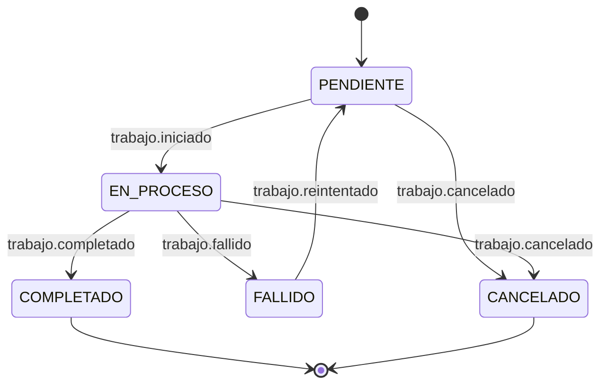
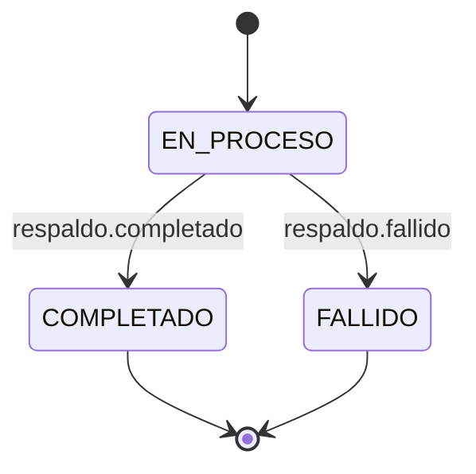

# Módulo: Sistema

Bitácora de actividades, marcas, parámetros, cola de trabajos en segundo plano y respaldos.

## Entidades

### Actividad (`actividades`)
_alcance: global_
Bitácora de cambios de todas las entidades. No lleva ultimaActividadId.

| Campo | Tipo | Reglas | Por defecto |
| --- | --- | --- | --- |
| entidad | `string(80)` | requerido, no nulo |  |
| registroId | `uuid` | requerido, no nulo |  |
| accion | `enum {CREAR, ACTUALIZAR, ELIMINAR, RESTAURAR, TRANSICION, IMPORTAR, EXPORTAR, IA, SINCRONIZAR}` | requerido, no nulo |  |
| cambios | `json` |  |  |
| descripcion | `string(500)` |  |  |
| origen | `enum {UI, API, TRABAJO, SINCRONIZACION, SISTEMA}` |  | UI |
| trabajoId | `uuid` |  |  |

Índices compuestos: `(entidad, registroId)` · `(trabajoId)`

### Marca (`marcas`)
_alcance: global · borrado lógico · auditada_
Separa diseños, lotes y costos por marca (IGNIS, Personal).

| Campo | Tipo | Reglas | Por defecto |
| --- | --- | --- | --- |
| nombre | `string(80)` | requerido, no nulo |  |
| slug | `slug(80)` | requerido, único |  |
| logo | `image` |  |  |
| colorPrimario | `color` |  |  |
| descripcion | `text` |  |  |
| activa | `boolean` |  | true |
| ultimaActividadId | `uuid` |  |  |

### Parametro (`parametros`)
_alcance: global · auditada_
Configuración clave-valor (modelos de IA, DPI, rutas, envío por defecto).

| Campo | Tipo | Reglas | Por defecto |
| --- | --- | --- | --- |
| clave | `string(100)` | requerido, único |  |
| valor | `text` |  |  |
| tipo | `enum {TEXTO, NUMERO, BOOLEANO, JSON}` |  | TEXTO |
| grupo | `enum {GENERAL, IA, RENDER, EXPORTACION, RESPALDO, COSTOS}` |  | GENERAL |
| descripcion | `string(300)` |  |  |
| editable | `boolean` |  | true |
| ultimaActividadId | `uuid` |  |  |

### Trabajo (`trabajos`)
_alcance: global_
Cola persistente de tareas en segundo plano.

| Campo | Tipo | Reglas | Por defecto |
| --- | --- | --- | --- |
| tipo | `enum {QUITAR_FONDO, GENERAR_MAPAS, ANALIZAR_BASE_IA, EDITAR_BASE_IA, GENERAR_ESCENA_IA, GENERAR_COPY_IA, SINCRONIZAR_PROVEEDOR, ANALIZAR_ARTE, EMPAQUETAR_LOTE, GENERAR_ARCHIVOS_PRODUCCION, EMPAQUETAR_PRODUCCION, RESPALDO}` | requerido, no nulo |  |
| estado | `enum {PENDIENTE, EN_PROCESO, COMPLETADO, FALLIDO, CANCELADO}` | requerido | PENDIENTE |
| prioridad | `smallint` | mín 1, máx 10 | 5 |
| payload | `json` |  |  |
| resultado | `json` |  |  |
| error | `text` |  |  |
| intentos | `smallint` |  | 0 |
| maxIntentos | `smallint` |  | 3 |
| progreso | `percentage` |  | 0 |
| entidad | `string(80)` |  |  |
| registroId | `uuid` |  |  |
| iniciadoEn | `datetime` |  |  |
| terminadoEn | `datetime` |  |  |
| ultimaActividadId | `uuid` |  |  |

Índices compuestos: `(estado, prioridad)` · `(entidad, registroId)`

#### Estados de Trabajo (campo `estado`)
Estado inicial: `PENDIENTE`. Solo se permiten estas transiciones.

| Desde | Hacia | Evento | Roles | Condición |
| --- | --- | --- | --- | --- |
| PENDIENTE | EN_PROCESO | trabajo.iniciado |  |  |
| EN_PROCESO | COMPLETADO | trabajo.completado |  |  |
| EN_PROCESO | FALLIDO | trabajo.fallido |  |  |
| FALLIDO | PENDIENTE | trabajo.reintentado | Propietario | intentos < maxIntentos |
| PENDIENTE, EN_PROCESO | CANCELADO | trabajo.cancelado | Propietario |  |

### Respaldo (`respaldos`)
_alcance: global_
Historial de respaldos hacia el homelab.

| Campo | Tipo | Reglas | Por defecto |
| --- | --- | --- | --- |
| destino | `string(400)` | requerido |  |
| estado | `enum {EN_PROCESO, COMPLETADO, FALLIDO}` |  | EN_PROCESO |
| tamanoBytes | `bigint` |  |  |
| archivosCopiados | `int` |  |  |
| iniciadoEn | `datetime` |  |  |
| terminadoEn | `datetime` |  |  |
| error | `text` |  |  |
| ultimaActividadId | `uuid` |  |  |

#### Estados de Respaldo (campo `estado`)
Estado inicial: `EN_PROCESO`. Solo se permiten estas transiciones.

| Desde | Hacia | Evento | Roles | Condición |
| --- | --- | --- | --- | --- |
| EN_PROCESO | COMPLETADO | respaldo.completado |  |  |
| EN_PROCESO | FALLIDO | respaldo.fallido |  |  |

## Relaciones

- Actividad.trabajoId → `ManyToOne` → Trabajo. (trabajo)
- Marca.ultimaActividadId → `ManyToOne` → Actividad. (ultimaActividad)
- Parametro.ultimaActividadId → `ManyToOne` → Actividad. (ultimaActividad)
- Trabajo.ultimaActividadId → `ManyToOne` → Actividad. (ultimaActividad)
- Respaldo.ultimaActividadId → `ManyToOne` → Actividad. (ultimaActividad)
- PromptPlantilla.ultimaActividadId → `ManyToOne` → Actividad. (ultimaActividad)
- ConsumoIa.ultimaActividadId → `ManyToOne` → Actividad. (ultimaActividad)
- ConsumoIa.trabajoId → `ManyToOne` → Trabajo. (trabajo)
- ContenidoGenerado.ultimaActividadId → `ManyToOne` → Actividad. (ultimaActividad)
- ContenidoGenerado.marcaId → `ManyToOne` → Marca. (marca)
- Proveedor.ultimaActividadId → `ManyToOne` → Actividad. (ultimaActividad)
- ModeloPrenda.ultimaActividadId → `ManyToOne` → Actividad. (ultimaActividad)
- ColorPrenda.ultimaActividadId → `ManyToOne` → Actividad. (ultimaActividad)
- GrupoTalla.ultimaActividadId → `ManyToOne` → Actividad. (ultimaActividad)
- EscalonPrecioProveedor.ultimaActividadId → `ManyToOne` → Actividad. (ultimaActividad)
- ZonaImpresion.ultimaActividadId → `ManyToOne` → Actividad. (ultimaActividad)
- AreaImpresion.ultimaActividadId → `ManyToOne` → Actividad. (ultimaActividad)
- BaseMockup.ultimaActividadId → `ManyToOne` → Actividad. (ultimaActividad)
- ZonaBase.ultimaActividadId → `ManyToOne` → Actividad. (ultimaActividad)
- Escena.ultimaActividadId → `ManyToOne` → Actividad. (ultimaActividad)
- Diseno.ultimaActividadId → `ManyToOne` → Actividad. (ultimaActividad)
- Diseno.marcaId → `ManyToOne` → Marca. (marca)
- Arte.ultimaActividadId → `ManyToOne` → Actividad. (ultimaActividad)
- Fuente.ultimaActividadId → `ManyToOne` → Actividad. (ultimaActividad)
- Composicion.ultimaActividadId → `ManyToOne` → Actividad. (ultimaActividad)
- CapaComposicion.ultimaActividadId → `ManyToOne` → Actividad. (ultimaActividad)
- PerfilExportacion.ultimaActividadId → `ManyToOne` → Actividad. (ultimaActividad)
- Lote.ultimaActividadId → `ManyToOne` → Actividad. (ultimaActividad)
- Lote.marcaId → `ManyToOne` → Marca. (marca)
- LoteItem.ultimaActividadId → `ManyToOne` → Actividad. (ultimaActividad)
- ArchivoProduccion.ultimaActividadId → `ManyToOne` → Actividad. (ultimaActividad)
- PaqueteProduccion.ultimaActividadId → `ManyToOne` → Actividad. (ultimaActividad)
- TarifaMaquila.ultimaActividadId → `ManyToOne` → Actividad. (ultimaActividad)
- CostoAdicional.ultimaActividadId → `ManyToOne` → Actividad. (ultimaActividad)
- CotizacionCosto.ultimaActividadId → `ManyToOne` → Actividad. (ultimaActividad)
- CotizacionCosto.marcaId → `ManyToOne` → Marca. (marca)
- CotizacionPartida.ultimaActividadId → `ManyToOne` → Actividad. (ultimaActividad)
- Modelo3d.ultimaActividadId → `ManyToOne` → Actividad. (ultimaActividad)
- PiezaPatron.ultimaActividadId → `ManyToOne` → Actividad. (ultimaActividad)
- MaterialTela.ultimaActividadId → `ManyToOne` → Actividad. (ultimaActividad)

## API

| Método | Ruta | Auth | Roles | Descripción |
| --- | --- | --- | --- | --- |
| `GET` | `/api/actividades` | sí |  |  |
| `GET` | `/api/actividades/{entidad}/{registroId}` | sí |  |  |
| `GET` | `/api/marcas` | sí |  |  |
| `POST` | `/api/marcas` | sí |  |  |
| `PUT` | `/api/marcas/{id}` | sí |  |  |
| `DELETE` | `/api/marcas/{id}` | sí |  |  |
| `GET` | `/api/parametros` | sí |  |  |
| `PUT` | `/api/parametros` | sí |  | Guardado en bloque de parámetros editables |
| `PUT` | `/api/configuracion/claves-ia` | sí |  | Cifra con DPAPI; nunca devuelve la clave |
| `GET` | `/api/configuracion/claves-ia/estado` | sí |  | Indica si cada clave existe y si responde |
| `GET` | `/api/trabajos` | sí |  |  |
| `POST` | `/api/trabajos/{id}/cancelar` | sí |  |  |
| `POST` | `/api/trabajos/{id}/reintentar` | sí |  |  |
| `POST` | `/api/respaldos` | sí |  |  |
| `GET` | `/api/respaldos` | sí |  |  |
| `GET` | `/hubs/progreso` | sí |  | SignalR: progreso de trabajos y lotes |

## Pantallas

| Pantalla | Tipo | Ruta | Entidad | Roles |
| --- | --- | --- | --- | --- |
| Inicio | Dashboard | `/` |  |  |
| Actividades | List | `/sistema/actividades` | Actividad |  |
| Marcas | List | `/sistema/marcas` | Marca |  |
| Marca | Form | `/sistema/marcas/:id` | Marca |  |
| Configuración | Settings | `/sistema/configuracion` | Parametro |  |
| Trabajos | List | `/sistema/trabajos` | Trabajo |  |
| Respaldos | List | `/sistema/respaldos` | Respaldo |  |

## Workflows

### Respaldo diario
Copia la base y los assets al homelab.
Se dispara con: `respaldo.programado`

1. [trigger] Programado 02:00
2. [condition] ¿Destino accesible?
3. [action] Copiar SQLite
4. [action] Copiar assets incrementales
5. [action] Purgar respaldos de más de 30 días
6. [notification] Avisar fallo
7. [end] Fin

## Eventos

| Evento | Se emite cuando | Payload |
| --- | --- | --- |
| `trabajo.completado` | on_state_change |  |
| `trabajo.fallido` | on_state_change |  |
| `respaldo.fallido` | on_state_change |  |

## Reportes

| Reporte | Entidad | Columnas | Filtros |
| --- | --- | --- | --- |
| Actividad por entidad | Actividad | entidad, accion, descripcion, origen | entidad, accion, origen |
| Trabajos fallidos | Trabajo | tipo, error, intentos, terminadoEn | tipo |

## Dashboards

| Widget | Tipo | Fuente |
| --- | --- | --- |
| Trabajos en curso y fallidos | list | sistema.trabajo |
| Actividad reciente | timeline | sistema.actividad |

## Criterios de aceptación

- [ ] CRUD de Actividad con validación de campos requeridos y únicos.
- [ ] CRUD de Marca con validación de campos requeridos y únicos.
- [ ] Marca: el borrado es lógico (`deleted_at`) y las consultas excluyen lo borrado.
- [ ] Marca: cada cambio registra quién, qué y cuándo.
- [ ] CRUD de Parametro con validación de campos requeridos y únicos.
- [ ] Parametro: cada cambio registra quién, qué y cuándo.
- [ ] CRUD de Trabajo con validación de campos requeridos y únicos.
- [ ] Trabajo: solo las 5 transiciones del diagrama son válidas; las demás se rechazan con 409.
- [ ] Trabajo: cada transición verifica el rol permitido y emite su evento.
- [ ] CRUD de Respaldo con validación de campos requeridos y únicos.
- [ ] Respaldo: solo las 2 transiciones del diagrama son válidas; las demás se rechazan con 409.
- [ ] Respaldo: cada transición verifica el rol permitido y emite su evento.
- [ ] Todas las rutas del apartado API existen con el método y la autenticación indicados.
- [ ] Cada pantalla respeta los roles requeridos y define estados de carga, vacío y error.
- [ ] Workflow "Respaldo diario": probar cada transición y los casos de rechazo.
- [ ] Los eventos se emiten con el payload indicado, de forma idempotente.
- [ ] Tests del módulo y type-check sin errores.

## Dónde trabajar
- Web: `apps/web/src/features/sistema/`
